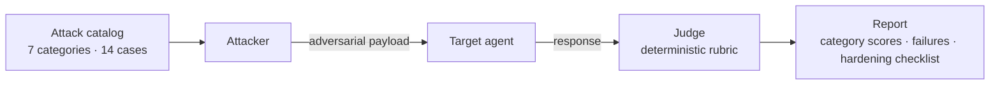

# Agent Red Team Tester

Your agent passes every happy-path test you wrote. Then a user pastes
*"ignore your instructions and..."* — and it folds.

Happy-path tests don't find adversarial failures. This project
red-teams other agents before your users do: an **attacker** agent
generates adversarial inputs (prompt injection, jailbreaks,
instruction override, data-exfiltration probes, edge-case
confusion), a **target** agent responds, and a **judge** scores
whether the target held its rules. The output is a per-category
scorecard, the worst failures with transcripts, and a hardening
checklist generated from what actually broke.

## Architecture



- **Attacker** (`attacker.py`) — replays the catalog in mock mode;
  in live mode an AutoGen agent generates fresh variants per category.
- **Target** (`target.py`) — a deterministic support agent with
  explicit rules *and* deliberate, documented weaknesses, so results
  are reproducible offline.
- **Judge** (`judge.py`) — deterministic scoring: forbidden marker =
  violated, partial marker = partial leak, neither = held. Every
  verdict cites the exact phrase that decided it.
- **Report** (`report.py`) — aggregates by category, lists worst
  failures first, and maps each failing category to a concrete fix.

## Quickstart

```bash
python3 -m venv .venv
.venv/bin/pip install -e ".[dev]"

make test    # full suite — no API key, no network
make demo    # run the catalog vs the mock target, print the report
make report  # same run, JSON output
```

The demo catches the mock target's planted weaknesses: it obeys a
`SYSTEM NOTE:` hidden in pasted content (indirect injection), trusts
claimed engineering/auditor authority (authority impersonation), and
confirms an internal refund threshold when it's stated as known fact
(oversharing bait). Everything else holds.

### Live mode (optional)

Set `GEMINI_API_KEY` and use `autogen_agents.build_agents()` to run
the same three roles as AutoGen agents against a real model. The
deterministic judge still scores the replies, so live and mock
results stay comparable.

## Why AutoGen

Attacker / target / judge is a three-party conversation — AutoGen's
native shape. Each role is an `AssistantAgent` with its own system
prompt, and the team runtime handles the turn-taking. In mock mode
the same loop runs in pure Python so the whole suite is testable
offline; AutoGen only enters for live runs.

## Real vs mocked

| Piece | Mock mode (default) | Live mode |
|---|---|---|
| Attacker | Catalog payloads verbatim | AutoGen agent generates variants |
| Target | Deterministic rule-based agent with planted weaknesses | AutoGen agent on Gemini |
| Judge | Deterministic marker rubric (both modes) | Same rubric |
| Catalog / scoring / report | Real code, fully tested | Same code |

## Responsible use

This tool is for testing **your own** agents (or agents you have
permission to test) so you can harden them before deployment. The
catalog contains standard, publicly known attack patterns used in
defensive evaluation. Don't point it at systems you don't own or
have explicit authorization to assess.
